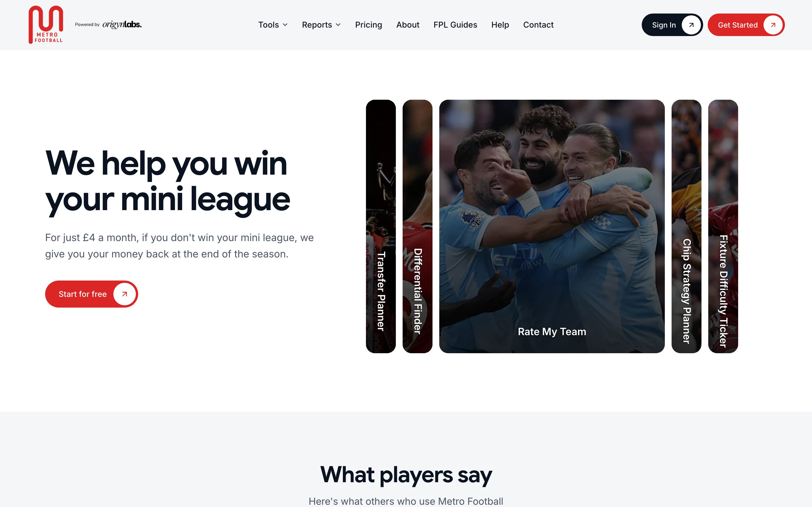
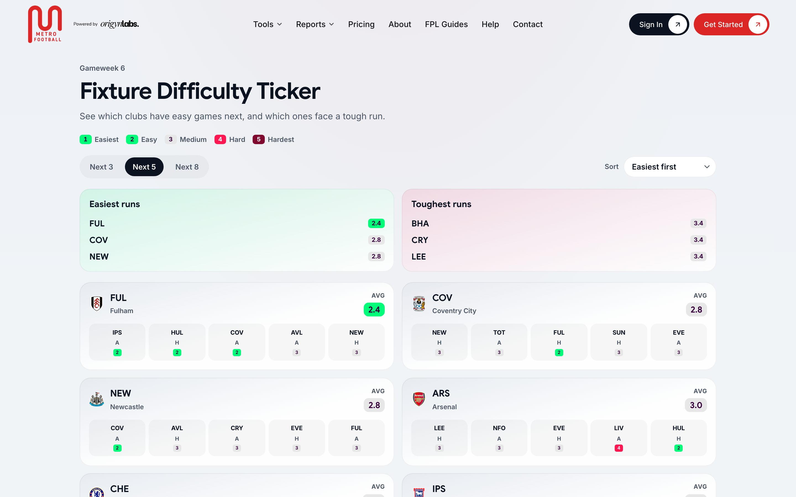
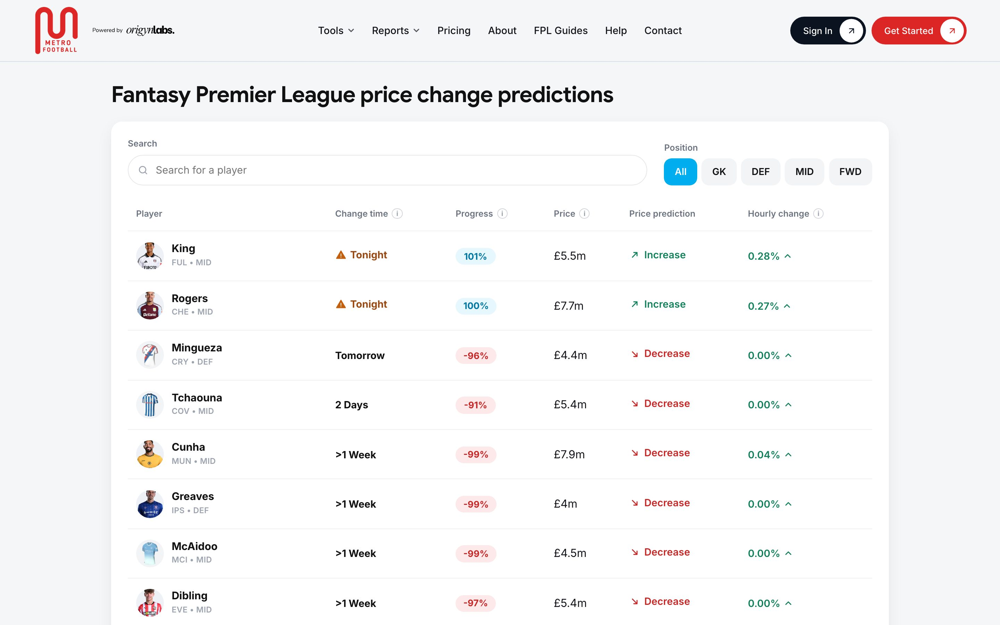
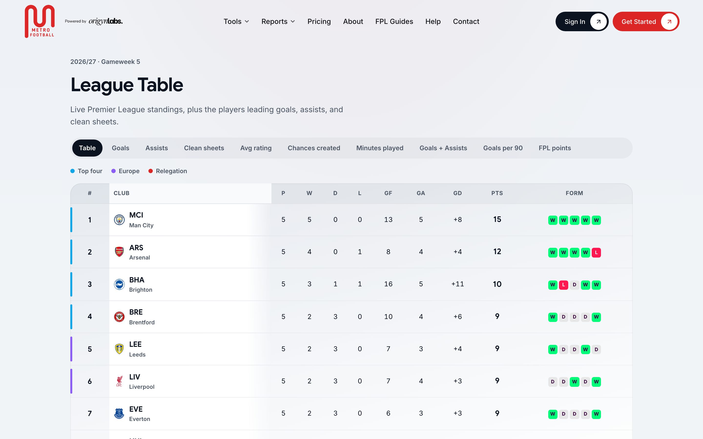
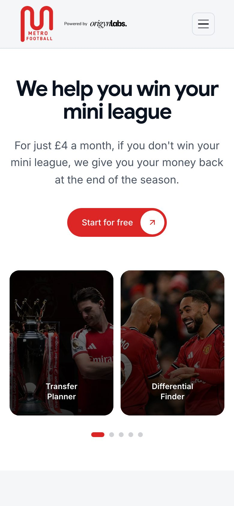
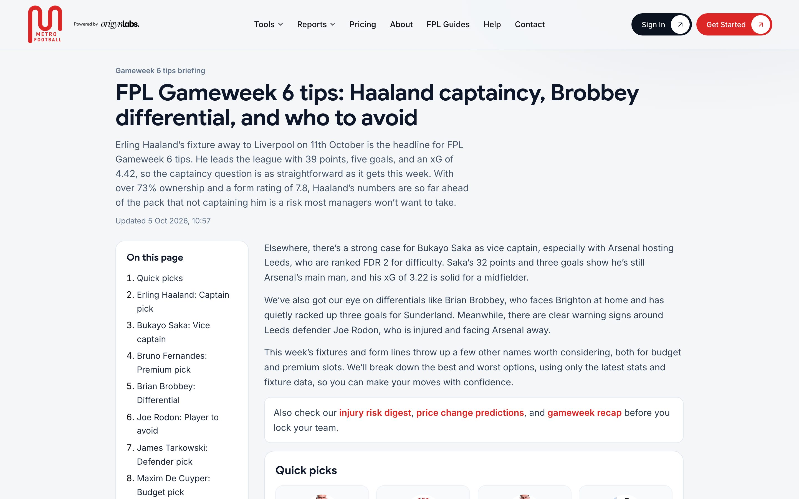
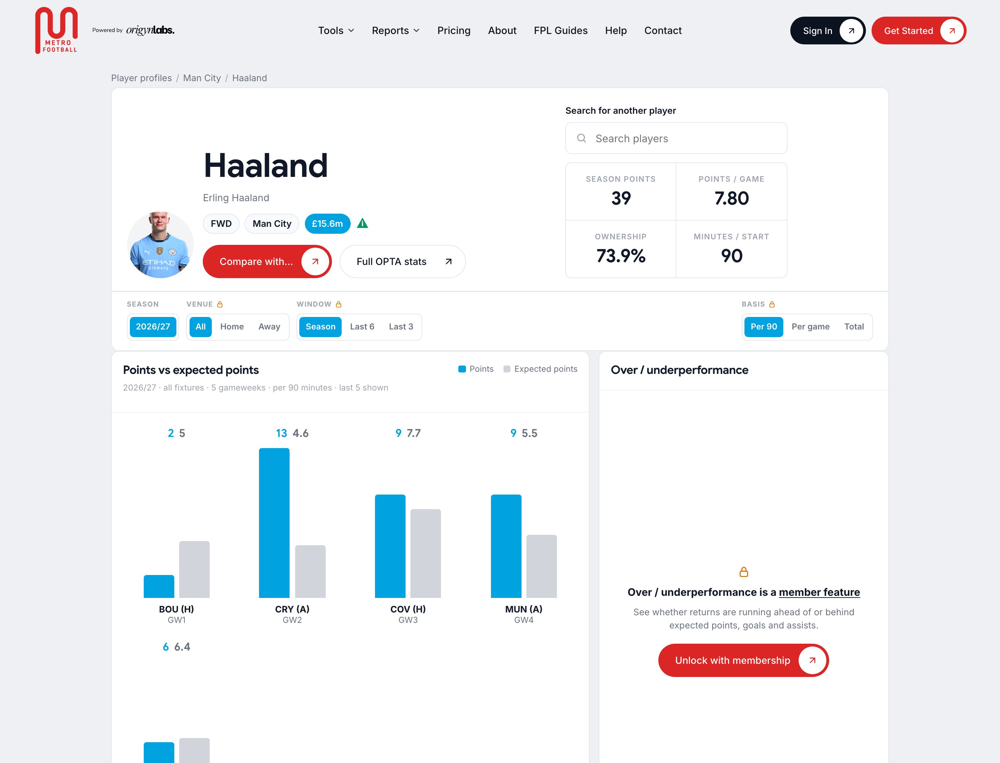
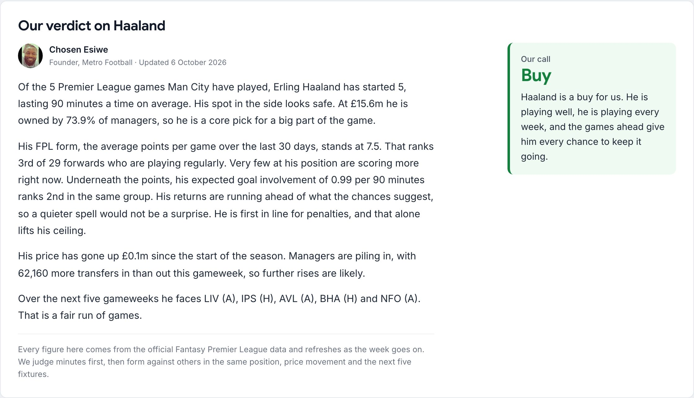
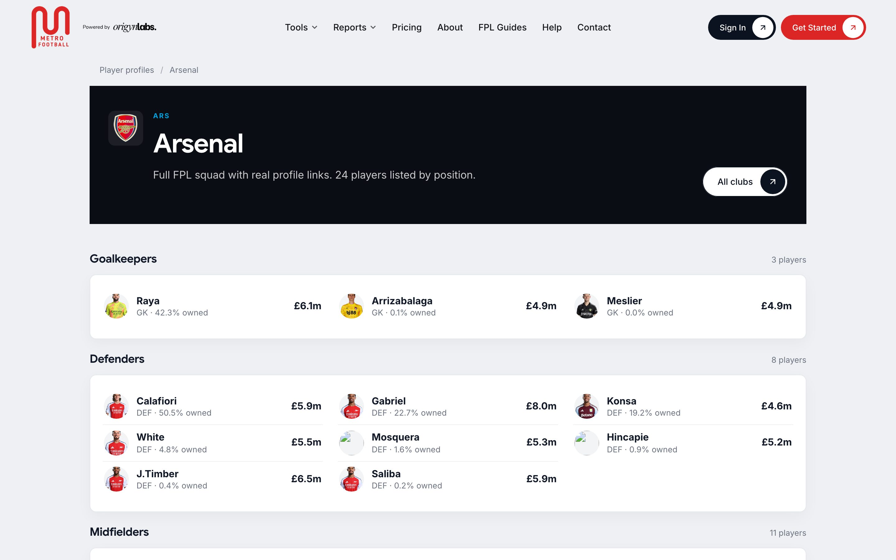
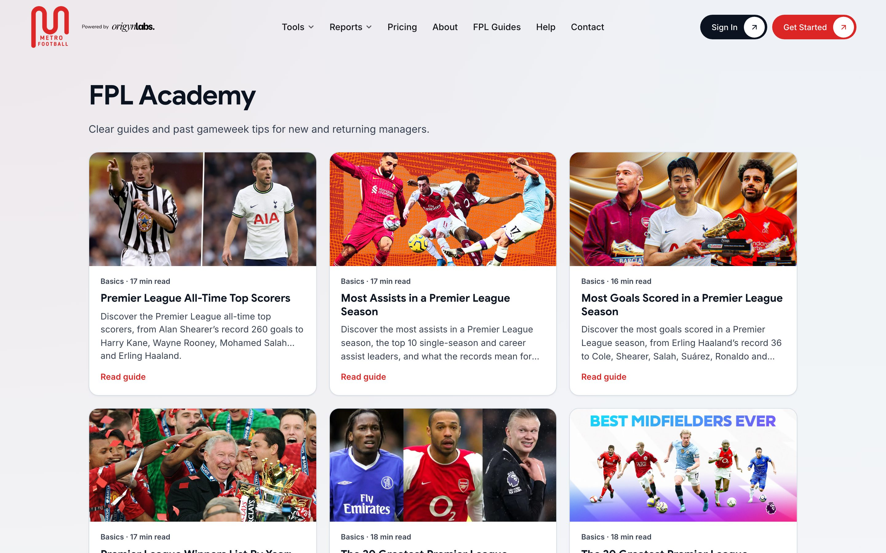

# Metro Football

Fantasy Premier League tools, reports and guides. Live at **[metrofootball.co.uk](https://metrofootball.co.uk)**.

I built this solo, end to end: product, design, backend, frontend, payments, email, hosting and the content pipeline. It runs in production on a single Hostinger shared hosting account, which shaped a lot of the decisions below.



## What it does

FPL managers spend hours every week on the same chores. They check fixtures, watch price changes, read injury news, pick a captain and argue about transfers. Metro Football does most of that groundwork and puts it next to the manager's own team.

There's a free tier and a Premium tier (monthly or yearly, billed through Flutterwave in GBP or NGN depending on where the visitor is).

**Free**

- Fixture difficulty ratings over the next six gameweeks, with a team by team grid
- Price change predictions, built from the progress fields FPL exposes
- A Premier League table computed from finished fixtures
- Player and club pages for every player and all 20 clubs, each with a written scouting report
- Weekly gameweek tips and a twice weekly injury digest
- Gameweek recap, a long form guides section with an author page, and a help center

**Premium**

- Pick: link your FPL team ID and get your squad back with projected points, captain picks and transfer ideas
- Live: your team's points during a gameweek
- Mini leagues, including a rival view that compares you against one manager in detail
- AI Teams: four squads built on different philosophies, plus season long teams tracked from gameweek 2
- AI Tips, AI Transfers, Chip Strategy and Rate My Team

<table>
  <tr>
    <td width="50%"></td>
    <td width="50%"></td>
  </tr>
  <tr>
    <td>Fixture difficulty over the next six gameweeks</td>
    <td>Price change predictions</td>
  </tr>
  <tr>
    <td width="50%"></td>
    <td width="50%" align="center"></td>
  </tr>
  <tr>
    <td>League table, computed from results</td>
    <td>Every page is built mobile first</td>
  </tr>
</table>

## Stack

| Layer | Choice |
| --- | --- |
| Backend | PHP 8.3, no framework, PSR-4 style classes under `app/` |
| Frontend | Static HTML and server rendered PHP pages, vanilla ES modules, plain CSS |
| Animation | [Motion](https://motion.dev) (vanilla build), always behind `prefers-reduced-motion` |
| Database | SQLite in WAL mode |
| Cache | Flat file JSON cache with fresh and stale windows |
| Data | The public FPL API |
| AI | OpenAI (`gpt-4o-mini` for most things, `gpt-4.1` for the weekly tips article), Tavily for news research |
| Payments | Flutterwave |
| Email | Resend for transactional mail and for the inbound side of the webmail |
| Auth | Email and password with one time codes, plus Google sign in |
| Hosting | Hostinger shared hosting, Apache, cron |

There's no build step. You edit a file and refresh the page. That was a deliberate call: the host can't run Node, and I wanted deploys to be a file upload, not a pipeline.

## Architecture

```
browser
  │
  ├── static pages (public/*.html)  ──fetch──►  JSON endpoints (public/api/**)
  │                                                    │
  └── server rendered pages (public/*.php)             │
          players, clubs, guides, tips                 ▼
                                               app/ services
                                                    │
                     ┌──────────────┬───────────────┼──────────────┬─────────────┐
                     ▼              ▼               ▼              ▼             ▼
                 FplClient       Database        OpenAiClient   Flutterwave    Resend
                 + FplCache      (SQLite)        TavilyClient
                     │
                     ▼
              fantasy.premierleague.com
```

**Pages.** Tool pages are static HTML that load their data from `public/api/fpl/*.php`. Anything that needs to rank in search (player profiles, club pages, guides, gameweek tips) is rendered on the server so crawlers get the full text without running JavaScript. The JS on those pages checks for a `data-*-ssr` flag and skips its own fetch, so there's no double render.

**Routing.** Apache rewrites in `.htaccess`. The root file maps everything into `public/`, so nothing outside `public/` is reachable over HTTP. Clean URLs like `/players/mohamed-salah` or `/fpl-gameweek-6-tips` map onto the PHP entry points.

**FPL data.** `FplClient` wraps the public API, and every call goes through `FplCache::rememberFreshOrStale`. The bootstrap payload is treated as fresh for two hours and can be served stale for up to twelve. If FPL is down (it goes down every deadline day) the site keeps serving the last good copy instead of erroring.

**Database.** One SQLite file, WAL mode, foreign keys on. `Database::pdo()` runs idempotent migrations on connect, so a fresh checkout creates its own schema on the first request. For the traffic this site sees, SQLite is plenty fast, there's no database server to manage, and a backup is one file copy. The webmail has its own SQL migrations in `database/migrations/`.

**Cron.** Four jobs, documented in `scripts/HOSTING-CRON.md`:

| When (UTC) | Script | Why |
| --- | --- | --- |
| Daily 06:00 | `cron-subscriptions.php` | Expire lapsed Premium, send renewal and expiry emails |
| Daily 04:15 | `build-player-ai-scores.php` | Rebuild projections for every player for the next gameweek |
| Tuesday 07:00 | `publish-gameweek-tips.php` | Write and publish the weekly tips article |
| Monday and Thursday 07:30 | `publish-injury-news.php` | Research and publish the injury digest |

Every content job exits early if the current gameweek is already published, so a double run costs nothing.

## The parts I'd point a reviewer at

### Projection engine

`app/PlayerProjectionEngine.php` gives every player an expected points figure for each of the next six gameweeks. It's position aware: keepers are scored on clean sheets, saves and goals conceded; defenders add attacking threat and defensive contribution; midfielders lean on creativity and xA; forwards have no clean sheet path at all. Raw xG and xA per 90 are shrunk towards a positional baseline for players with few minutes, so a winger who scored once in 40 minutes doesn't top the list. The result is then scaled by fixture difficulty and the opponent's actual goals for and against this season.

There are no hard coded player names anywhere in it. When a projection looks wrong, the fix has to be in the model, not a special case. It's on version 14.

### AI writes words, code does the maths

This is the rule I care most about. Every number on the site comes from PHP. The model never decides who to captain or how many points someone will score. It gets handed a structured pack of facts (projections, fixtures, ownership, price movement, injury status) and is asked to write sentences about them.

The weekly tips pipeline in `app/GameweekTipsService.php` works like this:

1. Pick candidates from the projections: captains, differentials, value picks, players to sell.
2. Build a fact pack for each one.
3. Ask the model for an article in a fixed JSON shape, with a long system prompt about voice and a list of words it isn't allowed to use.
4. Scrub the output anyway, because models ignore instructions. `scrubBannedWords` catches the usual filler and stray exclamation marks.
5. Validate before publishing: no duplicate players, every tip type present, every player ID real. If validation fails, the article doesn't publish.

Step 5 exists because of a real incident. One rewrite came back with the same defender in seven slots. The page then kept trying to repair itself on every request, which made it hang for nearly a minute. Now repairs only happen from the CLI, and a broken article is rejected before it can go live.

Every OpenAI call is logged with its model, token counts and calling service (`AiUsageLogger`), and the admin dashboard shows spend per feature.



### Player and club pages

There's a page for every player in the game and for every club, all rendered on the server and listed in a sitemap. Each one carries a written scouting report from `app/PlayerScoutReport.php`. It's plain PHP over public data: minutes and starts, how the player ranks against others in the same position and price band, underlying numbers, set piece duties, price trend and the next fixtures. It ends with a verdict (buy, hold, sell, watch or avoid).

Phrasing varies by player through a seeded pick (a crc32 of the player ID), so hundreds of pages don't read like one template, and the same player reads the same way on every visit.

One thing I found along the way: the team `played`, `win` and `position` fields in the FPL bootstrap are always zero. So the league table and the club pages compute standings from finished fixtures instead.

<table>
  <tr>
    <td width="50%"></td>
    <td width="50%"></td>
  </tr>
  <tr>
    <td>Player profile</td>
    <td>The written report and verdict further down the page</td>
  </tr>
</table>



### Payments

Flutterwave handles checkout. The flow is:

1. Create a pending payment row with our own `tx_ref`.
2. Redirect to Flutterwave.
3. On return, verify the transaction server side against their API before touching the subscription. The redirect query string is never trusted.

The webhook compares the `verif-hash` header to a shared secret with `hash_equals` and goes through the same verification path, so a payment confirmed by both the redirect and the webhook is only applied once. Prices are set in GBP and converted to NGN at checkout using a cached exchange rate. The app refuses to run with test keys in production.

### Auth

Sign up uses email and password, confirmed by a six digit one time code. Codes are hashed with `password_hash`, expire, and lock after five wrong attempts. Google sign in links to an existing account when the email matches. Sessions time out when idle, and Premium status is checked on the server for every gated endpoint, not just hidden in the UI.

### Webmail

`/mail` is a private webmail client for the company inboxes, built on Resend's inbound and outbound APIs. It has folders, attachments, signatures, inline images, a compose panel and user management. I built it because paying for Google Workspace seats for a few shared inboxes didn't make sense at this stage. `app/Mail/MailService.php` is the core, at about 2,000 lines, and it has its own CSRF and session handling.

### Admin and guides CMS

`/admin` has a dashboard (signups, revenue, AI spend), user management, payment history, email campaigns, and a block based editor for the guides section with image upload (iPhone HEIC photos are converted in the browser before upload). Guides render server side with a table of contents, internal links between articles, and structured data for search.



## Performance on cheap hosting

Shared hosting means no Redis, no queue workers, no CDN config and a slow disk. What made the difference:

- File cache with stale fallback for everything that touches FPL, plus cache warming scripts
- Fonts self hosted and subset to Latin (`scripts/subset-display-fonts.py`)
- Hero images and logos converted to WebP at three widths with `srcset`
- Third party scripts (analytics, ads) deferred so they don't block rendering
- Long running jobs (projections, article generation) only ever run from cron or the CLI, never in a web request

## Repository layout

```
app/                  Services. One class per feature, no framework.
  FplGuides/          Guide rendering, table of contents, internal links
  Mail/               Webmail core
config/.env.example   Every setting the app reads
database/migrations/  SQL migrations for the webmail (the main schema migrates in Database.php)
design-system/        Design tokens and page level notes (colours, type, buttons)
docs/screenshots/     Images used in this README
public/               Web root
  api/                JSON endpoints, grouped by area (auth, billing, fpl, admin, mail)
  admin/              Admin dashboard and guides editor
  mail/               Webmail
  partials/           Shared header, footer and page fragments
  css/ js/ images/
scripts/              Cron jobs, one off maintenance scripts, deploy helpers
storage/              Cache, logs and runtime data (not committed)
```

## Running it locally

You need PHP 8.3 with `pdo_sqlite`, `curl` and `mbstring`.

```bash
git clone https://github.com/Choboy-dev/metrofootball.git
cd metrofootball
cp config/.env.example config/.env      # fill in what you need
php -S localhost:8000 -t public
```

The SQLite database creates itself on the first request. Most free pages only need the FPL API, so they work with an empty `.env`. Payments, email, Google sign in and the AI features each need their own keys.

Two folders aren't in the repo:

- `public/fonts/`: the site uses Google Sans for headings, which I can't redistribute. It falls back to the system font stack without it. Inter is available from [rsms.me/inter](https://rsms.me/inter/).
- `public/js/vendor/`: third party builds. Save the ES module build of the `motion` package from npm as `motion.esm.js`, and the minified build of `heic2any` as `heic2any.min.js`.

The PHP dev server ignores `.htaccess`, so clean URLs won't resolve locally. Hit the files directly (`/player-profile.php?club=arsenal&player=saka`) or run it behind Apache.

## Deploying

Production is a plain file upload over SFTP to Hostinger. There's no build, so a deploy is copying the changed files. The scripts in `scripts/deploy-*.py` do it per feature area. They read credentials from a local, gitignored `config/sftp.json`. Cron entries are listed in `scripts/HOSTING-CRON.md`.

## Things I'd do differently with more room

- **Tests.** The projection engine and the billing flow deserve real test suites. Right now they're covered by one off check scripts and a lot of manual checking against live gameweeks.
- **A small router.** Rewrite rules in `.htaccess` worked fine for 40 pages. Past that I'd want routes defined in PHP.
- **A queue.** Article generation runs from cron with long timeouts because shared hosting has nothing better. On a VPS I'd move it to a worker.
- **Fewer static HTML pages.** The header and footer are duplicated across the static pages and kept in sync with scripts. Moving everything to PHP partials would remove that whole class of chore.

## Licence

The code is here for people to read. All rights reserved. Please don't redeploy it as your own product.
